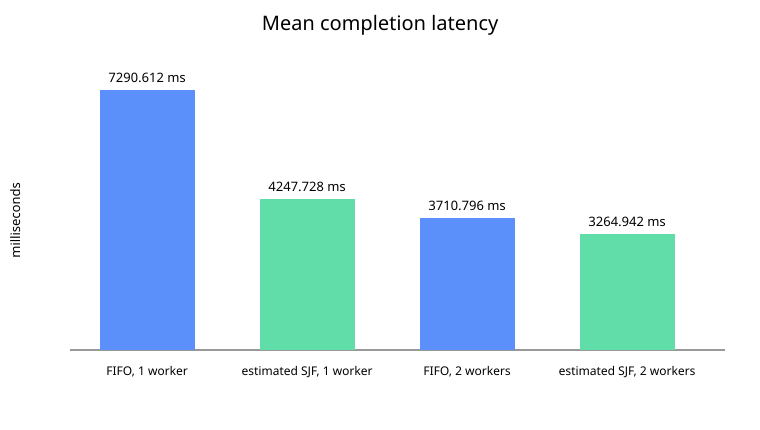

# Scheduling experiments

## Question and metrics

This experiment asks whether estimated shortest-job-first (SJF), using PDF page count as the
cost estimate, lowers completion latency compared with FIFO. SJF should lower the mean when a
backlog contains jobs with different runtimes and the estimate preserves their runtime order.
The benefit shrinks when jobs are similarly sized, estimates are poor, there is no backlog, or
enough workers can start every job immediately. Unlike FIFO, SJF can repeatedly delay large jobs
when short jobs keep arriving; the current non-preemptive policy provides no fairness guarantee.

For each job:

- queue wait = `started_at - submitted_at`
- run time = `finished_at - started_at`
- completion latency = `finished_at - submitted_at`

The primary metric is mean completion latency for successful jobs. The report also includes the
median, nearest-rank p95, maximum queue wait, mean latency by document size, successful documents
and pages per minute, failure count, and total wall time. Failed jobs are excluded from latency
aggregates but included in the failure count.

## Method

The fixed workload contains the three synthetic, image-only PDFs described in
[`samples/README.md`](../samples/README.md). They have one, two, and four pages and use clean,
mild-noise, and stronger-noise scan profiles respectively. Their content and noise are generated
locally with a fixed seed, so there are no external provenance or redistribution restrictions.

Every run submits the same `long`, `medium`, `small` burst while dispatch is paused, then releases
the full backlog. This makes the scheduling decision observable and gives both policies the same
arrival order. The four combinations of FIFO/estimated-SJF and one/two workers were each run three
times. A fixed seed randomized their order within each repetition to reduce systematic warm-up and
thermal bias. OCR used Tesseract's English model, 200 DPI rendering, and a two-minute per-document
timeout. No Tesseract thread limit was imposed, so worker-level concurrency may combine with
parallelism inside the OCR/native libraries.

The run took place on 2026-10-18 on Linux 7.2.10 (Fedora 44), an AMD Ryzen 7 5700U with eight
physical cores and 16 logical CPUs, and 14 GiB RAM. Software versions were Temurin Java 25+36,
Maven 3.9.11, PDFBox 3.0.8, and Tesseract 5.5.3 with Leptonica 1.87.0. No other deliberate workload
was running, but background OS activity, CPU frequency scaling, caching, and temperature were not
controlled.

## Results

All 36 jobs completed successfully; there were no failures or timeouts.

| Policy | Workers | Mean (ms) | Median (ms) | p95 (ms) | Max wait (ms) | Docs/min | Pages/min |
| --- | ---: | ---: | ---: | ---: | ---: | ---: | ---: |
| FIFO | 1 | 7,290.612 | 7,060.160 | 10,208.385 | 9,100.542 | 20.436 | 47.684 |
| Estimated SJF | 1 | 4,247.728 | 3,434.432 | 8,509.619 | 3,440.428 | 22.059 | 51.471 |
| FIFO | 2 | 3,710.796 | 3,663.497 | 5,147.903 | 2,684.157 | 36.741 | 85.730 |
| Estimated SJF | 2 | 3,264.942 | 2,442.477 | 6,157.100 | 1,329.074 | 30.059 | 70.138 |

Mean completion latency by document:

| Policy | Workers | Small, 1 page (ms) | Medium, 2 pages (ms) | Long, 4 pages (ms) |
| --- | ---: | ---: | ---: | ---: |
| FIFO | 1 | 8,799.359 | 7,666.768 | 5,405.711 |
| Estimated SJF | 1 | 1,166.715 | 3,416.676 | 8,159.794 |
| FIFO | 2 | 3,728.573 | 2,505.024 | 4,898.791 |
| Estimated SJF | 2 | 1,247.869 | 2,558.996 | 5,987.960 |



The raw observations are in [`raw.csv`](experiment-results/raw.csv), and the exact aggregates are
in [`summary.csv`](experiment-results/summary.csv).

## Interpretation

With one worker, estimated SJF lowered mean completion latency by 41.7% relative to FIFO. With two
workers, it lowered the mean by 12.0%. The smaller two-worker benefit is expected: two of the three
jobs can start immediately, leaving fewer scheduling choices. SJF also cut the observed maximum
queue wait by 62.2% with one worker and 50.5% with two, because the shortest job no longer waited
behind both larger documents.

The trade-off is visible in the per-size results. SJF made the four-page job complete 50.9% later
with one worker and 22.2% later with two. FIFO therefore remains the fairer default when submission
order matters, while estimated SJF is useful when reducing average latency is more important and
page count is a reasonable runtime estimate.

Throughput should not materially change from reordering the same non-preemptive workload, but the
measured values did vary: one-worker SJF was 7.9% higher than FIFO, while two-worker SJF was 18.2%
lower. The raw run times indicate machine/caching/concurrency variation rather than work saved by
the policy. These small experiments support a latency conclusion, not a throughput conclusion.

## Limitations

- Three documents and three repetitions are enough to demonstrate the scheduling effect, but not
  to estimate production behavior. With only nine observations per condition, nearest-rank p95 is
  effectively the worst observation and is unstable.
- Page count and scan difficulty are confounded: the longer PDFs also have more noise. A larger
  factorial corpus should vary page count and scan quality independently.
- The full-backlog burst favors policies that can inspect all jobs. Staggered arrivals, continuous
  load, cancellation, failures, and inaccurate estimates were not benchmarked.
- Policy order was interleaved, but the process was not restarted between runs and OS load, cache
  state, CPU scaling, and temperature were not controlled.
- Tesseract/native-library parallelism was not pinned. Two scheduler workers may oversubscribe
  resources, so worker-count results are specific to this machine and configuration.
- SJF has no aging mechanism. Under sustained arrivals, large jobs can wait indefinitely; fairness
  aging is intentionally left to the optional post-MVP work described in the project plan.

## Reproduce

Install Java 25, Maven 3.9.11, Tesseract with the English language data, and then run from the
repository root:

```bash
./mvnw clean package
java -jar target/ocr-laundry.jar generate-samples samples
java -jar target/ocr-laundry.jar experiment samples docs/experiment-results 3
```

The last command overwrites the three result files. Absolute timings will differ by machine, so
compare policies from the same interleaved run rather than comparing these values with a separate
machine.
